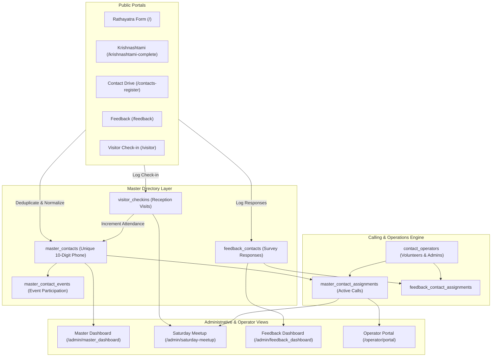
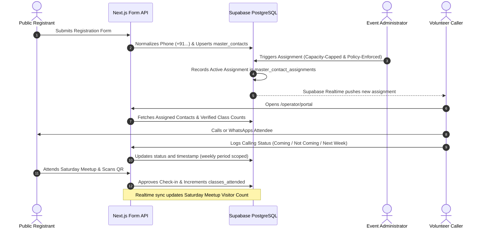

# MECM – Multi-Event CRM Platform

[](https://nextjs.org/)
[](https://react.dev/)
[](https://www.typescriptlang.org/)
[](https://supabase.com/)
[](https://tailwindcss.com/)
[](https://mecm.vercel.app)

**MECM** (Multi-Event CRM Platform) is an enterprise-grade event management, attendee lifecycle tracking, volunteer coordination, and calling operations platform. It aggregates high-volume public event registrations, normalizes and deduplicates master contacts, manages caller assignments with capacity controls, tracks weekly Saturday Meetup attendance and class histories, and delivers real-time operational analytics for large-scale cultural and community gatherings.

* **Production URL:** [https://mecm.vercel.app](https://mecm.vercel.app)
* **Target Audience:** Administrators, Calling Operators, Event Volunteers, and Public Attendees.

---

## Table of Contents

1. [Project Overview](#project-overview)
2. [Key Features](#key-features)
3. [Technology Stack](#technology-stack)
4. [Architecture & Workflow](#architecture--workflow)
5. [Directory Structure](#directory-structure)
6. [Installation & Local Setup](#installation--local-setup)
7. [Environment Variables](#environment-variables)
8. [Database Setup & Migrations](#database-setup--migrations)
9. [Application Routes](#application-routes)
10. [Production Build & Deployment](#production-build--deployment)
11. [Testing & Verification](#testing--verification)
12. [Security & Access Control](#security--access-control)
13. [Screenshots](#screenshots)
14. [Contributing & License](#contributing--license)

---

## Project Overview

Organizations hosting recurring community festivals and weekly youth sessions frequently struggle with fragmented attendee data, overlapping spreadsheets, lack of caller assignment accountability, and disconnect between reception desks and calling teams.

**MECM** solves these challenges by centralizing all event interactions into a single source of truth:

* **Centralized Master Contacts:** Deduplicates entries across diverse festivals (*Rathayatra*, *Sri Krishnashtami*, *College Contact Drives*) using normalized 10-digit Indian phone numbers.
* **Controlled Calling Pipeline:** Assigns contacts to active volunteer operators with strict capacity limits (e.g., maximum 40 calls per operator), organizational policy filters (such as female contact safety exclusions), and calling status progression.
* **Saturday Meetup & Class Attendance Tracking:** Connects walk-in visitor check-ins directly with calling lists, maintaining total verified class attendance counts and chronological session history.
* **Weekly Automated Rollover:** Automatically archives previous Saturday Meetup statistics and resets weekly calling counters every Friday at 00:00 IST while permanently preserving contact assignments and attendance milestones.
* **Comprehensive Analytics & Reporting:** Real-time dashboards with unlimited, batched CSV export and printable PDF reports across all administrative modules.

---

## Key Features

### 1. Multi-Event & Registration Management
* **Festival Portals:** Dedicated public landing and registration interfaces for major festivals (Rathayatra, Sri Krishnashtami, and Special Contact Drives).
* **Instant Validation & Persistence:** Client-side draft saving (`localStorage`), duplicate mobile number checks, and Geoapify address autocomplete.
* **Registration Passes & QR Codes:** Instant confirmation screen generating dynamic QR codes encoding secure verification URLs for reception check-in.

### 2. Master Contact Directory (`/admin/master_dashboard`)
* **Unified Identity:** Canonical Master Contact records tracking full profile data, area of stay, college/occupation, chanting rounds, and student levels (`Level 1`, `Level 2`, `Level 3`).
* **Cross-Event History:** Tracks every event an individual has participated in over time.
* **Bulk & Manual Assignment:** Assign single or multiple contacts to operators with real-time capacity validation.

### 3. Operator Management & Calling Operations (`/admin/operators`)
* **Operator Roster:** Manage volunteer operators, active status toggles, language capabilities, and maximum assignment caps.
* **Fail-Closed Protection:** Ensures female contacts cannot be assigned to operators, enforcing organization policy across auto and manual assignment pipelines.
* **Realtime Assignment Synchronization:** Instant status updates via Supabase Realtime channels.

### 4. Operator Portal (`/operator/portal`)
* **Secure Authentication:** Independent JWT cookie authentication powered by `bcryptjs` and HTTP-only session cookies.
* **Streamlined Calling UI:** Mobile-first, responsive dark interface with single-tap direct Phone dialer (`tel:`) and pre-formatted WhatsApp chat links.
* **Authoritative Status Tracking:** Record immediate responses:
  * `Assigned` (Initial state)
  * `Coming` (Confirmed attendee)
  * `Not Coming`
  * `Not Answered`
  * `Next Week` (Call back next cycle)
* **Class Attendance View & History Modal:** Displays verified `Classes Attended: X` beside each contact name; clicking opens an interactive history modal detailing session dates, meetup titles, and approving admin.

### 5. Saturday Meetup Dashboard (`/admin/saturday-meetup`)
* **Synchronized Visitor Metrics:** Live counters reconciling approved visitor check-ins with calling lists.
* **Weekly Rollover Engine:** Resets weekly call counters (`Coming`, `Not Coming`, `Not Answered`, `Next Week`, `Pending`) every Friday at 00:00 IST without resetting assignments or lifetime class attendance.
* **Historical Meetup Archive:** Permanent archive of previous Saturday attendance records for trend analysis.

### 6. Visitor Check-In System (`/visitor`)
* **Reception Desk Portal:** Fast walk-in registration and badge scanning at event premises.
* **Master Contact Auto-Linking:** Automatically connects new check-in records to existing Master Contacts by phone number and increments verified class attendance.

### 7. Feedback Dashboard (`/admin/feedback_dashboard`)
* **Student Feedback Analytics:** Real-time metrics for hundreds of post-event feedback submissions.
* **Dynamic Multi-Filtering:** Real-time calculation of Satisfaction Rates, Online Workshop Conversions, Ratings breakdown (Excellent/Good/Not Applicable), and Accommodation breakdown (With Parents vs. In Hostel).
* **Secure Operator Assignment Controls:** Manual assignment workflow without accidental bulk auto-assignments.

### 8. Enterprise Reporting & Unlimited Export
* **No 1,000-Record Ceiling:** Custom batched retrieval loops bypass standard Supabase query limits.
* **Export CSV:** Full UTF-8 BOM encoding with standard escaping and timestamps.
* **Print / Export PDF:** Multi-page print layout with repeated table headers and executive metric cards.

---

## Technology Stack

| Layer | Technology | Details |
| :--- | :--- | :--- |
| **Framework** | Next.js 16 (App Router) | High-performance React framework with Server & Client components |
| **UI Library** | React 19 | Latest React architecture with concurrent features |
| **Language** | TypeScript 5 | End-to-end type safety across components, APIs, and database schemas |
| **Styling** | Tailwind CSS v4 | Modern styling engine with PostCSS, Lucide Icons, and Next Themes |
| **Database & BaaS** | Supabase (PostgreSQL 15+) | Cloud PostgreSQL with Row Level Security (RLS) & Realtime Pub/Sub |
| **Server Operations**| Node.js / `pg` | PostgreSQL client for administrative migrations and direct queries |
| **Testing Engine** | `@electric-sql/pglite` | In-memory PostgreSQL 16 WASM engine for headless isolation tests |
| **Auth & Security** | JWT & bcryptjs | Cookie-based session management for operators; Supabase Auth for admins |
| **Form Management** | React Hook Form & Zod v4 | Declarative schema validation and sanitized payload handling |
| **Data Viz** | Recharts | Interactive SVG chart components for metric dashboards |
| **Motion & Confetti**| Framer Motion & Canvas Confetti | Smooth UI micro-interactions and celebration banners |
| **QR Code Engine** | `qrcode` | Dynamic client and server QR generation for passes and URL routing |

---

## Architecture & Workflow

### Data Architecture Overview



### Assignment & Calling Lifecycle



---

## Directory Structure

```text
rathayatra/
├── docs/                           # Architectural guides & product requirements
├── public/                         # Static assets (favicons, manifest, icons, sw.js)
├── scripts/                        # Database migration, verification & testing scripts
│   ├── build-sw.js                 # Service worker compilation script
│   ├── test-operator-class-attendance.ts  # Attendance view verification
│   ├── test-weekly-counter-reset.ts# Weekly rollover test suite (PGlite)
│   ├── test-unlimited-export-print.ts     # Export limit regression test
│   └── run-sql-migration.ts        # Supabase SQL migration runner
├── src/
│   ├── app/                        # Next.js App Router
│   │   ├── admin/                  # Protected administrative dashboards
│   │   │   ├── contacts-register/  # Contact drive management
│   │   │   ├── dashboard/          # General analytics overview
│   │   │   ├── feedback_dashboard/ # Student feedback analysis & export
│   │   │   ├── master_dashboard/   # Master contacts central directory
│   │   │   ├── operators/          # Operator capacity & roster management
│   │   │   ├── registrations/      # Event registrations table
│   │   │   ├── saturday-meetup/    # Saturday meetup live attendance & history
│   │   │   └── services/           # Service & volunteer slots management
│   │   ├── api/                    # Server-side API endpoints
│   │   │   ├── assignments/        # Assignment engine & status updates
│   │   │   ├── feedback/           # Feedback submission & batched reporting
│   │   │   ├── operator/           # Operator attendance history endpoint
│   │   │   ├── operators/          # Operator authentication & weekly resets
│   │   │   ├── saturday-meetup/    # Saturday meetup stats & historical archive
│   │   │   └── visitor/            # Check-in, approval & attendance logs
│   │   ├── contacts-register/      # Public contact drive form
│   │   ├── feedback/               # Public attendee feedback form
│   │   ├── krishnashtami-complete/ # Krishnashtami registration portal
│   │   ├── operator/               # Operator authentication & /operator/portal
│   │   ├── qr/                     # Dynamic QR generation & print hub
│   │   ├── rathayatra-complete/    # Rathayatra registration portal
│   │   ├── visitor/                # Public/Reception walk-in check-in form
│   │   ├── layout.tsx              # Root HTML & provider setup
│   │   └── page.tsx                # Responsive MECM landing page
│   ├── components/                 # Reusable UI & layout components
│   │   ├── landing/                # Modern MECM landing page components
│   │   ├── AdminShell.tsx          # Common admin navigation sidebar & header
│   │   ├── qr-modal.tsx            # Printable QR modal with download options
│   │   └── providers.tsx           # React Query & Theme providers
│   └── lib/                        # Core utilities, business logic & DB clients
│       ├── master-contacts.ts      # Phone normalization & master upsert logic
│       ├── operator-auth.ts        # JWT & bcrypt operator authentication
│       ├── qr-url-resolver.ts      # Canonical QR destination URL resolver
│       ├── status-normalizer.ts    # Weekly calling status aggregator
│       ├── supabase-admin.ts       # Service-role Supabase client (Server-only)
│       ├── supabase.ts             # Anon public Supabase client (Browser)
│       ├── types.ts                # TypeScript domain models & interfaces
│       └── weekly-period.ts        # Friday 00:00 IST calculation helpers
├── supabase/
│   └── migrations/                 # Chronological SQL migrations (00 to 44)
├── .env.example                    # Environment variable template
├── package.json                    # Project dependencies & scripts
└── tsconfig.json                   # TypeScript configuration
```

---

## Installation & Local Setup

### Prerequisites

* **Node.js:** `v20.x` or higher recommended (compatible with Node `v18.18.0+`)
* **npm:** `v9.x` or `v10.x`
* **Git:** Installed and configured
* **Supabase Account:** Access to a Supabase project with PostgreSQL 15+

### Step-by-Step Installation

1. **Clone the repository:**
   ```bash
   git clone https://github.com/Bharath-723/HKM.git
   cd HKM
   ```

2. **Install project dependencies:**
   ```bash
   npm install
   ```

3. **Configure environment variables:**
   ```bash
   # Windows PowerShell
   Copy-Item .env.example .env.local

   # macOS / Linux
   cp .env.example .env.local
   ```

4. **Fill in `.env.local`:**
   Open `.env.local` and provide your Supabase project API keys (see [Environment Variables](#environment-variables)).

5. **Start the local development server:**
   ```bash
   npm run dev
   ```

6. **Open the application:**
   Navigate to [http://localhost:3000](http://localhost:3000) in your browser.

---

## Environment Variables

All supported environment variables are detailed below. Ensure sensitive keys are never committed or exposed on public clients.

| Variable Name | Required? | Location / Scope | Description |
| :--- | :---: | :--- | :--- |
| `NEXT_PUBLIC_SUPABASE_URL` | **Yes** | Public (Client & Server) | Base URL for your Supabase project (e.g., `https://xyz.supabase.co`). |
| `NEXT_PUBLIC_SUPABASE_ANON_KEY` | **Yes** | Public (Client & Server) | Supabase anonymous public key used for client queries subject to RLS. |
| `SUPABASE_SERVICE_ROLE_KEY` | **Yes** | **SECRET** (Server-only) | Service role key used by administrative API routes and scripts to bypass RLS. |
| `OPERATOR_JWT_SECRET` | **Yes** | **SECRET** (Server-only) | Secret phrase used to sign and verify operator JWT session cookies. |
| `NEXT_PUBLIC_APP_URL` | Optional | Public (Client & Server) | Production root domain (e.g., `https://mecm.vercel.app`) used to build QR destinations. |
| `NEXT_PUBLIC_KRISHNASHTAMI_WHATSAPP_URL` | Optional | Public (Client) | WhatsApp group invite URL displayed on festival registration success pages. |
| `GEOAPIFY_API_KEY` | Optional | **SECRET** (Server-only) | Key for address autocomplete lookup in public forms. |

> [!CAUTION]
> **Security Notice**: Never paste `SUPABASE_SERVICE_ROLE_KEY` into browser client code or commit `.env.local` to source control.

---

## Database Setup & Migrations

The database is built on PostgreSQL with Supabase extensions. Migrations reside in `supabase/migrations/` and track the evolution of schemas, triggers, and stored procedures.

### Key Database Tables

| Table | Purpose |
| :--- | :--- |
| `master_contacts` | Canonical identity table for unique individuals (indexed by normalized phone). Stores level and lifetime `classes_attended`. |
| `master_contact_events` | Relational join table mapping attendees to events with specific ticket, prasadam, and accommodation choices. |
| `master_contact_assignments`| Calling assignments linking operators to master contacts, tracking call status and weekly period. |
| `master_contact_checkins` | Check-in audit log for Saturday Meetups with timestamp and approving admin. |
| `contact_operators` | Operator roster storing active status, role (`caller` vs. `admin`), languages, and assignment caps. |
| `visitor_checkins` | Reception desk walk-in records, status tracking, and visitor notes. |
| `feedback_contacts` | Attendee survey submissions, ratings, and workshop interest. |
| `feedback_contact_assignments` | Assignment records for operator follow-ups on feedback submissions. |
| `admins` | Administrative users authorized to manage assignments, system settings, and exports. |

### Applying Migrations

> [!IMPORTANT]
> Always inspect migration files before executing them. Migrations should be executed in strict numerical sequence.

1. Open your **Supabase Dashboard** -> **SQL Editor**.
2. Review migration files in `supabase/migrations/` starting from `20260626000000_init_schema.sql` through `20261114100000_visitor_count_sync_and_indexes.sql`.
3. Apply migrations sequentially or utilize your preferred Supabase CLI workflow:
   ```bash
   npx supabase db push
   ```

---

## Application Routes

### Public Pages
* **`/`** — Responsive MECM Landing Page & Overview
* **`/rathayatra-complete`** — Rathayatra Festival Public Registration Portal
* **`/krishnashtami-complete`** — Sri Krishnashtami Festival Public Registration Portal
* **`/contacts-register`** — Specialized Contact Drive Collection Form
* **`/visitor`** — Public / Walk-in Reception Visitor Check-in Form
* **`/feedback`** — Attendee Feedback & Experience Form
* **`/qr`** — Public & Administrative QR Code Resolution Hub
* **`/success`** — Registration Confirmation & Pass Display

### Operator Portal
* **`/operator`** — Operator Secure Login Portal
* **`/operator/portal`** — Calling Workspace (Direct Dialing, WhatsApp, Status Logging, Notes & Attendance History)
* **`/operator/visitor`** — On-site Operator Reception Desk

### Administrative Dashboards
* **`/admin/dashboard`** — Executive Platform Analytics
* **`/admin/master_dashboard`** — Central Master Contact Directory & Deduplicated Records
* **`/admin/operators`** — Caller Allocation, Capacity Management & Weekly Counters
* **`/admin/saturday-meetup`** — Saturday Meetup Attendance, Approvals & Historical Archive
* **`/admin/feedback_dashboard`** — Student Feedback Metrics, Ratings & Unlimited Export
* **`/admin/registrations`** — Festival Registrations Data Table & Assignment Controls
* **`/admin/contacts-register`** — Contact Drive Registrations & Calling Pipeline
* **`/admin/services`** — Volunteer Services & Slot Scheduling

---

## Production Build & Deployment

### Build Script
The project includes an automatic service-worker compilation step before running the Next.js production build:

```bash
npm run build
```

This triggers:
1. `node scripts/build-sw.js` (Generates offline Service Worker in `public/sw.js`)
2. `cross-env NODE_OPTIONS=--max-old-space-size=4096 next build` (Compiles optimized production bundle with memory headroom)

### Vercel Deployment

The project is pre-configured for continuous deployment via [Vercel](https://vercel.com):

1. **Connect Repository:** Link your GitHub repository in the Vercel Dashboard.
2. **Framework Preset:** Select `Next.js`.
3. **Environment Variables:** Add all required variables (`NEXT_PUBLIC_SUPABASE_URL`, `NEXT_PUBLIC_SUPABASE_ANON_KEY`, `SUPABASE_SERVICE_ROLE_KEY`, `OPERATOR_JWT_SECRET`, `NEXT_PUBLIC_APP_URL`).
4. **Deploy:** Push changes to the `main` branch to trigger automated production deployment.

* **Live Production Instance:** [https://mecm.vercel.app](https://mecm.vercel.app)

---

## Testing & Verification

The repository includes a comprehensive suite of automated verification scripts located in `scripts/`:

```bash
# 1. Verify TypeScript Compilation (0 errors)
npx tsc --noEmit --incremental false

# 2. Run ESLint Code Quality Checks
npm run lint

# 3. Test Weekly Counter Reset & Visitor History Engine (Isolated in-memory Postgres)
npx tsx scripts/test-weekly-counter-reset.ts

# 4. Test Operator Class Attendance & Identity Matching
npx tsx scripts/test-operator-class-attendance.ts

# 5. Verify Unlimited Export & Print Functionality
npx tsx scripts/test-unlimited-export-print.ts
```

---

## Security & Access Control

* **Multi-Tier Role Separation:**
  * **Public Users:** Restricted by PostgreSQL Row Level Security (RLS) to `INSERT` only on designated public tables.
  * **Operators:** Authenticated via standalone HTTP-only JWT cookies (`operator-session`) verified against active records in `contact_operators`. Operators can only read and mutate their own assigned contacts.
  * **Administrators:** Authenticated via Supabase Auth and verified against the `admins` table. Only admins can trigger batch assignments, reassign callers, or download complete data exports.
* **Fail-Closed Gender Protection:** Database and API constraints strictly exclude female contacts from caller queues, ensuring complete adherence to organizational safety policies.
* **Input Sanitization:** All incoming requests are validated against strict Zod schemas before touching database layers.

---

## Screenshots

| View | Description |
| :--- | :--- |
| **Landing Page** | High-conversion responsive landing page with dark theme, festival navigation, and organization partners. |
| **Operator Portal** | Caller queue with direct Phone/WhatsApp triggers, status selection, and **Classes Attended** history. |
| **Saturday Meetup** | Real-time visitor arrival counter, pending calls reconciliation, and weekly historical meetups. |
| **Master Dashboard** | Deduplicated database of attendees across all campaigns with chanting rounds and assignment states. |
| **Feedback Dashboard** | Analytics cards, satisfaction ratings, stay distribution, and unlimited CSV / PDF export. |

*(Place screenshots in `docs/screenshots/` and update references as needed).*

---

## Contributing & License

### Contributing
1. Fork the repository and create a feature branch (`git checkout -b feature/amazing-feature`).
2. Run TypeScript (`npx tsc --noEmit --incremental false`) and lint checks (`npm run lint`).
3. Commit your changes with clear messages (`git commit -m 'feat: add amazing feature'`).
4. Push to your branch and open a Pull Request.

### License
This project is proprietary and maintained for Hare Krishna Movement (HKM) and MECM event operations. All rights reserved. For licensing inquiries, contact the development and administrative teams.

---

*MECM Platform Documentation — Updated November 2026.*
